# SeptronUniverse — Architecture Diagrams

Same stack and layering as SeptronOrbit; diagrams below show what is specific to higher education and to the hardened platform (tenancy hierarchy, four-layer authorization, feature flags, outbox, workflow engine, registration and exam lifecycles, result versioning).

---

## 1. System overview (infrastructure)

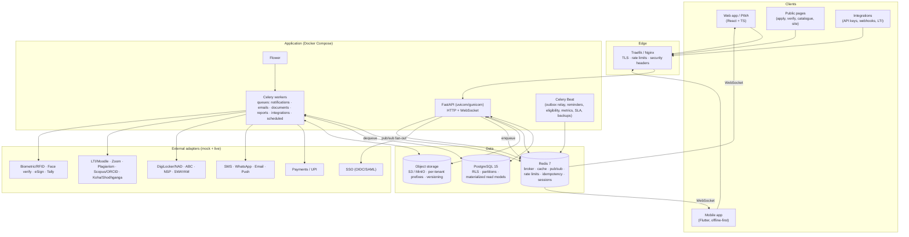

---

## 2. Backend request pipeline

```mermaid
graph LR
    REQ["Request"] --> MW1["GZip"] --> MW2["CORS"] --> MW3["RequestLogger\n(request_id, tenant, user)"] --> MW4["InstitutionContext\nX-Institution-* / X-College-Id\nSET LOCAL app.institution_id"]
    MW4 --> RO["ReadOnlyMode gate"] --> AUTH["JWT + session check\n(get_current_user)"]
    AUTH --> F["feature_required(key)"] --> P["permission_required(module, action)"] --> SC["Scope\n(user_roles.scope_type/scope_id)"]
    SC --> ROUTE["Route\n(validate → service → ok())"]
    ROUTE --> SVC["Service\nrules · log_audit · events.emit"]
    SVC --> REPO["BaseRepository\ninstitution + scope + soft-delete + visible_to(user)"]
    REPO --> PG[("PostgreSQL (RLS)")]
    SVC --> OUT["domain_events (outbox)\nsame transaction"]
    OUT --> RELAY["Relay (Beat / LISTEN-NOTIFY)"] --> CEL["Celery consumers"]
    ROUTE --> ENV["Envelope\n{success, data, message, meta:{visibility, pagination}}"]
```

---

## 3. Tenancy hierarchy & scopes

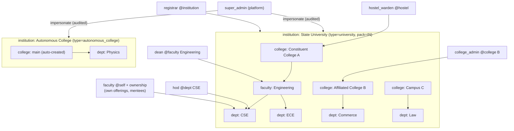

---

## 4. Four-layer authorization & visibility

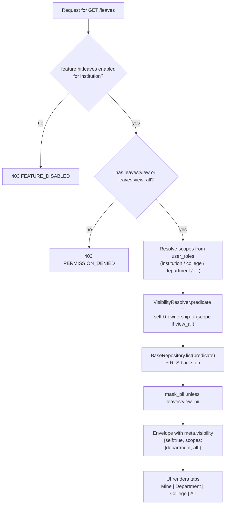

Accountant example: `leaves:view_all` @institution → predicate = own leaves ∪ all leaves; UI shows **Mine** and **All**.

---

## 5. Feature-flag flow

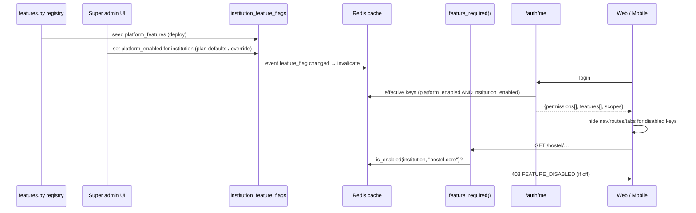

---

## 6. Transactional outbox

```mermaid
sequenceDiagram
    participant SVC as Service
    participant PG as PostgreSQL
    participant RELAY as Outbox relay (Beat)
    participant RD as Redis broker
    participant C1 as Notifications consumer
    participant C2 as Webhooks consumer
    participant C3 as ABC / DigiLocker consumer

    SVC->>PG: BEGIN; UPDATE result rows; INSERT domain_events(result.published); COMMIT
    RELAY->>PG: SELECT pending events FOR UPDATE SKIP LOCKED
    RELAY->>RD: publish to consumers
    RD->>C1: result.published → templates → SMS/push (idempotent by event_id)
    RD->>C2: result.published → signed webhook (retry, dead-letter)
    RD->>C3: push abc_credit_ledger rows (retry)
    C1-->>PG: message_logs
    C3-->>PG: abc_credit_ledger.status = pushed/acknowledged
```

---

## 7. Approval-workflow engine

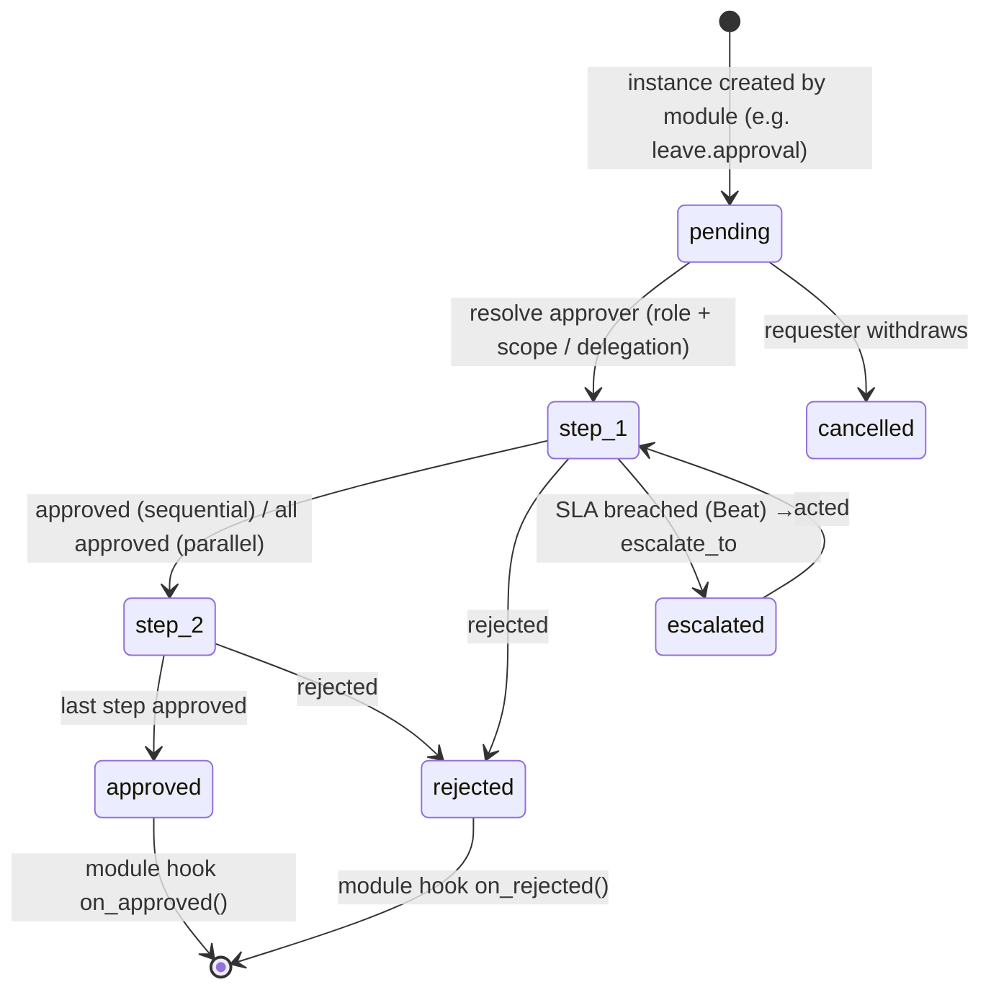

---

## 8. Course registration flow

```mermaid
sequenceDiagram
    actor S as Student
    participant UI as Registration page / app
    participant API as /registration
    participant SVC as RegistrationService
    participant PG as PostgreSQL
    participant WF as Workflow
    participant FEE as Fees

    S->>UI: open cart (window open?)
    UI->>API: GET /registration/me/catalog?term_id
    API->>SVC: curriculum + arrears + baskets − holds
    SVC-->>UI: eligible offerings, credit limits
    S->>UI: add offerings, elective priorities
    UI->>API: POST /registration/me/items (Idempotency-Key)
    API->>SVC: prerequisite / co-requisite / anti-requisite / seat check
    SVC->>PG: SELECT course_offerings FOR UPDATE; enrolled_count++ or waitlist
    S->>UI: submit
    UI->>API: POST /registration/me/submit
    SVC->>PG: hold check (registration|all), fee clearance
    SVC->>WF: start advisor approval (if window requires)
    SVC->>FEE: invoice (tuition + arrear credits + late fee) source_type=course_registration
    WF-->>SVC: approved → items confirmed
    SVC->>PG: emit registration.approved (outbox)
    Note over PG: auto-lock at add_drop_end; later drops = W
```

---

## 9. Examination lifecycle

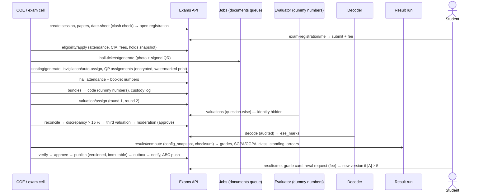

---

## 10. Result versioning & immutability

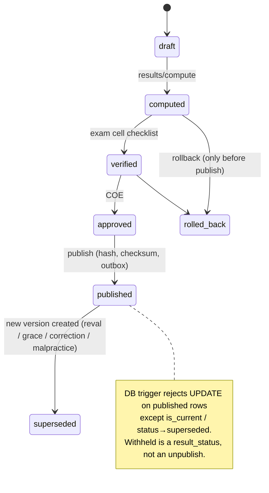

---

## 11. Module dependency map

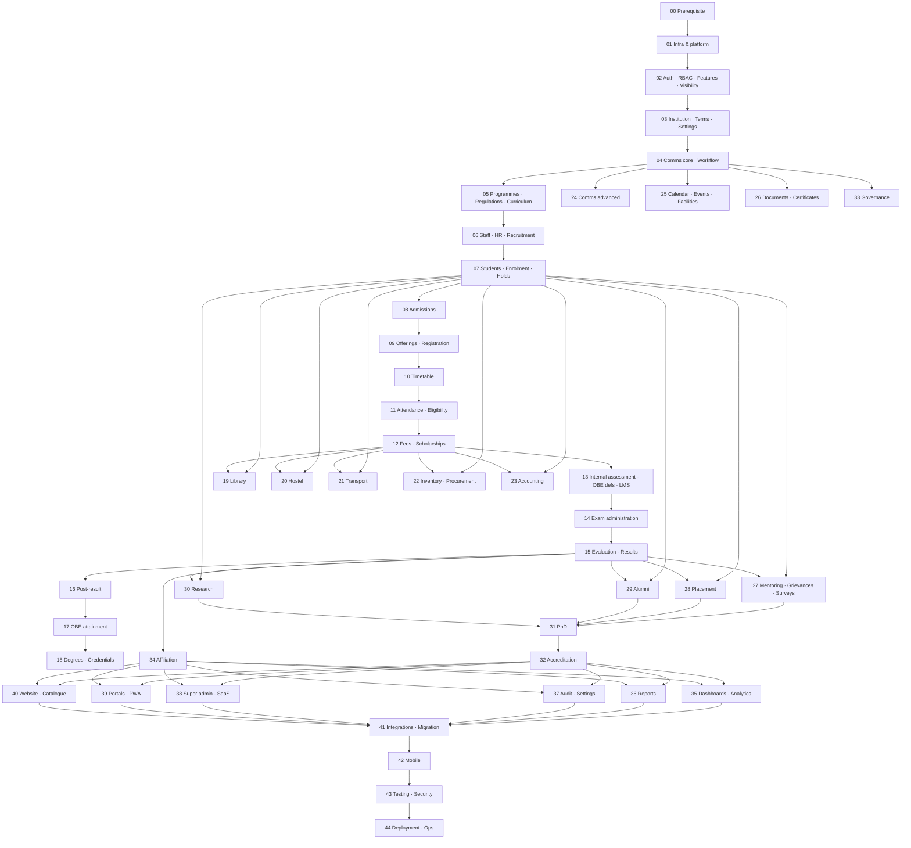

---

## 12. Academic core ERD (key tables)

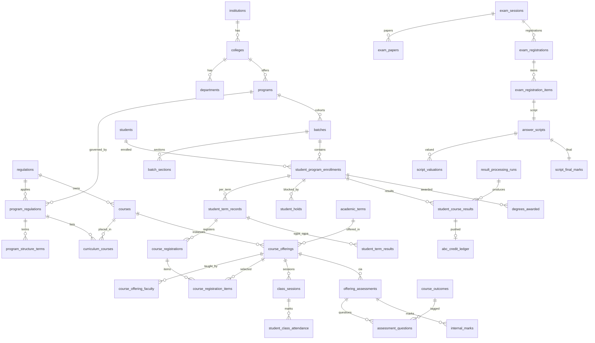

---

## 13. Docker Compose topology

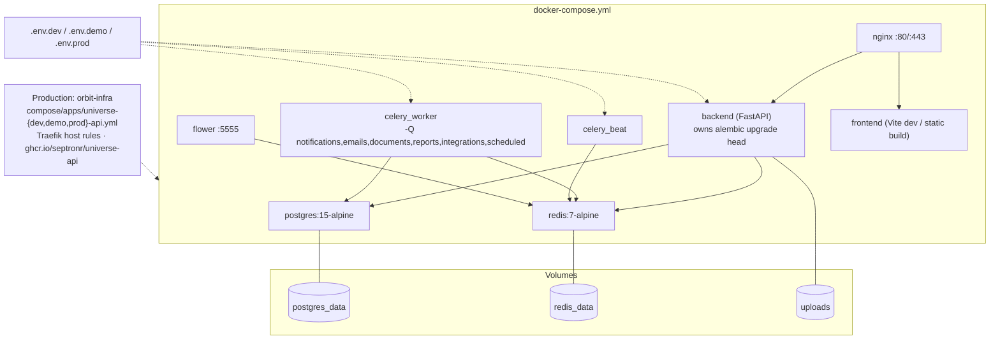

---

## 14. Mobile role shell

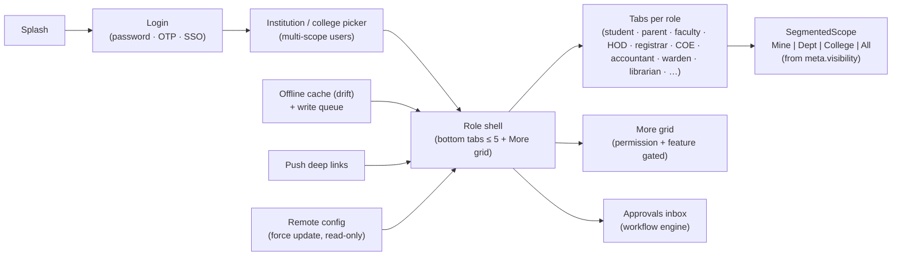

---

*SeptronUniverse — College & University ERP · FastAPI · PostgreSQL · Redis · Celery · React 18 · TypeScript · Tailwind · Flutter*
